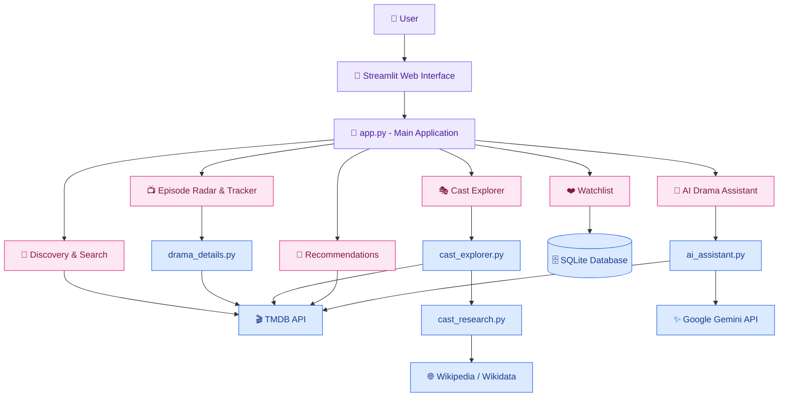
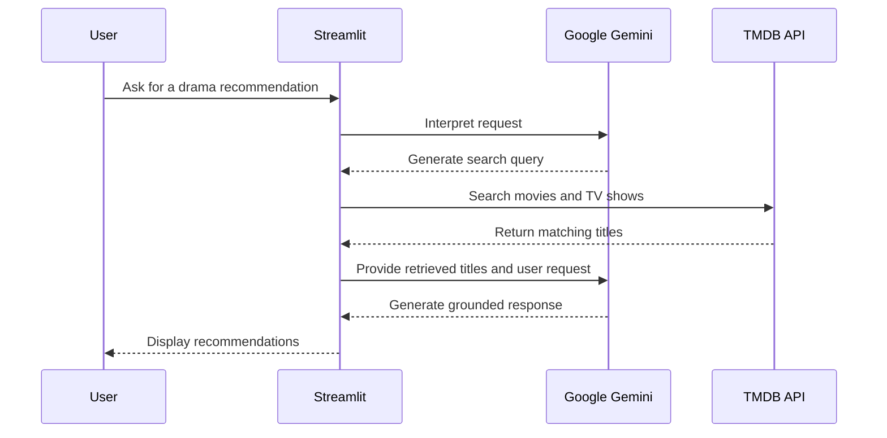

<div align="center">

# 💜 VKJVerse AI

### Your Universe of Stories ♡

**Discover stories. Explore stars. Follow episodes. Find your next obsession.**

An AI-powered entertainment discovery application bringing K-Dramas, C-Dramas, Thai BL/GL, J-Dramas, Indian cinema, and global movies into one cozy universe.

<br>


<br>

[✨ Features](#-features) • [🏗️ Architecture](#️-system-architecture) • [🚀 Installation](#-getting-started) • [🔮 Roadmap](#-future-enhancements)

---

*Every great story deserves to be discovered. ✨*

</div>

## 🌸 About the Project

**VKJVerse AI** is an interactive movie and drama discovery platform developed using **Python, Streamlit, TMDB API, and Google Gemini**.

The application combines entertainment discovery, cast research, episode tracking, personalized recommendations, and an AI-powered drama assistant in a single web interface.

Instead of visiting multiple platforms to explore shows, find actors, or check upcoming episodes, users can discover and organize their favorite entertainment through VKJVerse AI.

The application features a custom purple-themed interface, interactive movie cards, and dedicated tools for drama enthusiasts.

### 🌏 Explore Stories Across Borders

🇰🇷 K-Dramas · 🇨🇳 C-Dramas · 🇹🇭 Thai Dramas & BL/GL · 🇯🇵 J-Dramas · 🇮🇳 Indian Cinema · 🌎 Global Movies & Series

---

## ✨ Features

### 🏠 1. Home Dashboard
- Explore trending movies and dramas from the current week.
- Browse popular television series.
- View posters, ratings, release dates, and descriptions.
- Save interesting titles directly to your watchlist.

### 🔥 2. Trending Entertainment
- Discover trending movies and television series.
- Switch between daily and weekly trending content.
- Filter results by movies, TV series, or all entertainment.
- Explore popularity information retrieved from TMDB.

### 🔎 3. Movie & Drama Search
- Search for movies and television series by title.
- Explore results across languages and countries.
- View ratings, release dates, posters, and descriptions.
- Add discovered titles to your personal watchlist.

### 🌏 4. World Explorer
Discover entertainment based on country of origin.

Supported countries include:
- South Korea
- China
- Japan
- Thailand
- India
- Taiwan
- Philippines
- United States
- United Kingdom
- Turkey

Browse movies and TV series ordered by TMDB popularity.

### 📅 5. Episode Radar
- Search for your favorite television dramas.
- Find the next episode listed by TMDB.
- View upcoming episode numbers and air dates.
- Check information about the last aired episode.

### 📺 6. Advanced Episode Tracker

A dedicated drama tracking module that provides:

- Drama synopsis, genres, language, country, and networks
- Series status and TMDB ratings
- Total seasons and episode counts
- Released, upcoming, and unscheduled episode statistics
- Next episode countdown
- Upcoming episode release schedule
- Complete season-by-season episode guide
- Episode descriptions, runtime, and available images

**Note:** Episode dates are based on TMDB's original broadcast information and may differ from streaming-platform release schedules.

### 🎭 7. Cast Explorer
- Discover cast members associated with dramas and movies.
- Explore available actor and actress information.
- Access cast research through dedicated Python modules.
- Enrich available information using Wikipedia and Wikidata sources.

### 🤖 8. Drama Recommendations
- Enter a movie or drama you already enjoy.
- Select the matching title.
- Discover similar movies and series using TMDB recommendations.
- Explore new entertainment based on existing titles.

**Recommendation engine:** TMDB's recommendation API.

### ❤️ 9. Personal Watchlist
- Save movies and television series.
- View saved titles in a dedicated watchlist.
- Remove titles when they are no longer needed.
- Store watchlist records locally using SQLite.

The application uses a local database named `vkjverse_watchlist.db`.

### 💬 10. Gemini AI Drama Assistant

A conversational entertainment assistant powered by **Google Gemini** and grounded in TMDB search results.

The assistant follows a multi-step workflow:

1. Interprets the user's natural-language request.
2. Converts the request into a TMDB search query.
3. Retrieves matching movie and television titles.
4. Uses Gemini to generate a response based on the retrieved titles.

The assistant is designed to recommend real titles from the retrieved TMDB results rather than inventing entertainment information.

> AI responses depend on Gemini API availability, supported models, and usage quotas.

---

## 🏗️ System Architecture

VKJVerse AI uses a modular Python architecture with Streamlit as the user interface, TMDB as the primary entertainment data source, Gemini for conversational AI, and SQLite for local watchlist storage.



### AI Assistant Workflow



---

## 🛠️ Technology Stack

| Category | Technologies |
|---|---|
| Programming Language | Python |
| Web Framework | Streamlit |
| Entertainment Data | TMDB API |
| Generative AI | Google Gemini API |
| Local Database | SQLite |
| HTTP Communication | Requests |
| Environment Management | python-dotenv |
| AI SDK | google-genai |
| Knowledge Sources | Wikipedia, Wikidata |
| Version Control | Git & GitHub |
| Development Environment | Visual Studio Code |

### Technical Highlights

- REST API integration and JSON response processing
- Modular Python application development
- Generative AI integration with external data retrieval
- SQLite CRUD operations for watchlist management
- API response caching with Streamlit
- Exception handling and retry logic for temporary Gemini server errors
- Custom CSS styling and interactive Streamlit components
- Git feature-branch development and merging

---

## 📁 Project Structure

```text
VKJVerse-AI-Complete/
│
├── app.py                  # Main Streamlit application
├── ai_assistant.py         # Gemini AI assistant and TMDB search
├── cast_explorer.py        # Cast Explorer interface
├── cast_research.py        # Cast research functionality
├── drama_details.py        # Drama and episode data processing
│
├── .streamlit/             # Streamlit configuration
├── .env.example            # API credential template
├── .gitignore              # Excluded files
├── requirements.txt        # Python dependencies
├── README.md               # Project documentation
│
├── check_models.py         # Gemini model testing utility
├── test_gemini.py          # Gemini API testing
└── test_drama_details.py   # Drama details testing
```

**Runtime files:** The application also creates a local SQLite watchlist database when needed. The `.env` file is created separately and should never be committed to GitHub.

---

## 🚀 Getting Started

### Prerequisites

Before running VKJVerse AI, make sure you have:

- Python installed
- Git installed
- A TMDB API Read Access Token
- A Google Gemini API key

### Step 1 — Clone the Repository

```bash
git clone https://github.com/KrishiJyothirmaiV/VKJVerse-AI-Complete.git
cd VKJVerse-AI-Complete
```

### Step 2 — Install Dependencies

```powershell
py -m pip install -r requirements.txt
```

The project's requirements include:

- `streamlit`
- `requests`
- `python-dotenv`
- `google-genai`

SQLite support is provided through Python's standard library.

### Step 3 — Configure API Credentials

Create a `.env` file in the project root.

Add the following environment variables:

```env
TMDB_READ_TOKEN=your_tmdb_read_access_token
GEMINI_API_KEY=your_gemini_api_key
```

You can use `.env.example` as a reference.

> 🔐 Never upload your real `.env` file or expose API keys in a public repository.

### Step 4 — Launch VKJVerse AI

```powershell
py -m streamlit run app.py
```

### Step 5 — Open the Application

Streamlit will usually start the application at:

**http://localhost:8501**

You can now explore VKJVerse AI locally! 💜

---

## 📸 Application Screenshots

Screenshots of the working application can be added here.

| Home Dashboard | World Explorer |
|:---:|:---:|
| Screenshot coming soon | Screenshot coming soon |

| Episode Tracker | Cast Explorer |
|:---:|:---:|
| Screenshot coming soon | Screenshot coming soon |

| AI Drama Assistant | Personal Watchlist |
|:---:|:---:|
| Screenshot coming soon | Screenshot coming soon |

---

## 🔮 Future Enhancements

VKJVerse AI is an evolving personal project.

- [ ] Dedicated BL/GL genre and category filtering
- [ ] Weekly drama popularity and fan-voting analytics
- [ ] Interactive global drama release calendar
- [ ] Episode release notifications
- [ ] Advanced preference-based recommendations
- [ ] Watch progress tracking
- [ ] Multilingual discovery improvements
- [ ] Enhanced cast profiles and filmographies
- [ ] Cloud-based watchlist synchronization
- [ ] Public deployment and mobile UI improvements

---

## 🎯 Project Purpose

VKJVerse AI was created to combine an interest in international entertainment with practical experience in software development and artificial intelligence.

The project demonstrates:

- Building an end-to-end Python web application
- Integrating multiple external APIs
- Developing a conversational AI workflow
- Processing entertainment metadata
- Implementing local database persistence
- Designing interactive dashboards and user interfaces
- Organizing code into reusable modules
- Using Git and GitHub for feature development and version control

---

## 👩‍💻 Developer

**Krishi Jyothirmai Vadaparthi**

*Python • Data Analytics • AI Application Development*

VKJVerse AI is a personal portfolio project inspired by a love for international dramas, movies, and AI-powered technology.

**GitHub:** [@KrishiJyothirmaiV](https://github.com/KrishiJyothirmaiV)

---

## 📜 Disclaimer & Acknowledgments

This product uses the **TMDB API** but is not endorsed or certified by TMDB.

Entertainment metadata and images belong to their respective owners and providers.

VKJVerse AI is an independent personal development project created for educational and portfolio purposes.

Special thanks to TMDB, Streamlit, Wikipedia, Wikidata, and the open-source developer community.

---

<div align="center">

### 💜 VKJVerse AI

**Your Universe of Stories ♡**

*Discover new worlds. Fall in love with new stories. Explore without limits.*

Made with 💜 and Python.

⭐ **If you enjoy this project, consider starring the repository!**

</div>
